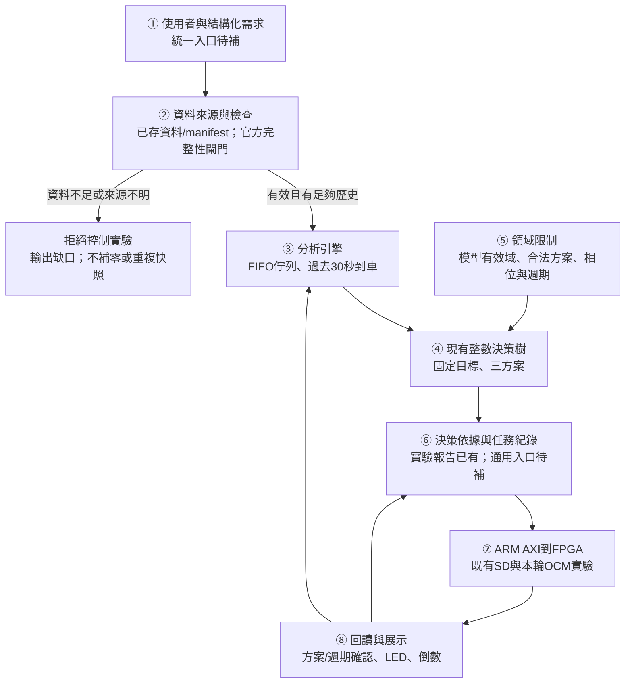
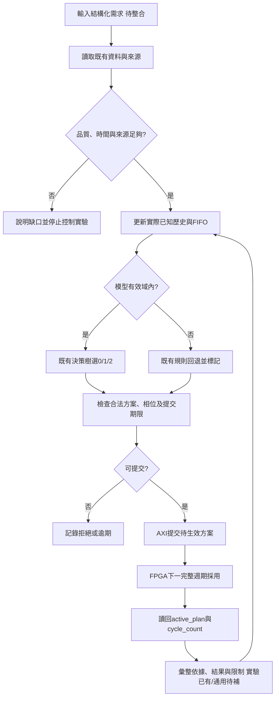

# 交通配時助手系統設計

更新日期 2026-10-30。題目：交通配時助手，分析車流、選擇配時方案，並以開發板驗證執行結果。以既有 ARM 決策樹與 FPGA 為主線，客觀比較限固定配時與現有模型政策。文件收斂後另完成保存輸入的主機重播及固定/模型兩輪 OCM 暫存實板比較；原專案程式與 SD 映像保留。

## 1 問題與使用者需求

需求不同的兩個方向共用有限綠燈時間，固定配時未必與當前需求相符。使用者需要知道資料是否能用、目前選哪個合法配時、選擇依據為何，以及指令是否真的生效。本系統以單路口兩軸直行桌上原型支援這些問題；效益限目前實驗範圍，沒有實際道路部署證據。

完整 Domain AI Agent 的目標流程是「輸入需求、檢查資料、分析並選方案、提供依據、執行及回讀」。目前已完成板端數值決策迴路；實驗專用自動依據/結果報告已新增；通用需求入口與任務層整合仍待補。結構化需求即可作為最小入口，不強制 LLM 或自由文字聊天。

## 2 本輪需求與狀態

| 需求 | 實作/證據 | 狀態 |
|---|---|---|
| 保留既有模型與三方案 | embedded/model/traffic_model.c、firmware/traffic_agent.c | 已有 |
| 固定 30 秒週期與倒數 | rtl/traffic_fsm.v、embedded/rtl/traffic_axi.v | 已有實板功能證據 |
| 使用相同輸入比較固定 vs. 模型 | 歷史 firmware_validation.json 與本輪實驗報告 | 歷史 18 組、本輪 6 組主機與 1 組實板配對分開保存 |
| 結構化需求與資料批次識別 | 分散的 CLI/manifest 與人工操作 | 統一入口待補 |
| 輸出特徵/方案/理由/生效證據 | 歷史欄位及本輪 strict 驗證/自動配對報告 | 實驗報告已有；通用 Agent 任務整合待補 |
| 官方資料只做離線處理 | embedded/data/taipei/ | 已有單分鐘整理；控制實驗未成立 |
| 保留歷史證據 | proposal/history/2026-10-30_before_scope/ 與各次原始記錄 | 本輪保留 |

三方案 NS/EW 綠燈分別為 12/12、16/8、8/16 秒。每方向黃燈 2 秒、全紅 1 秒為本展示設定，不是一般道路標準。相位為 NS 綠、NS 黃、全紅、EW 綠、EW 黃、全紅；只有綠燈顯示剩餘秒數。新方案在完整週期邊界生效，不重啟當前倒數。

## 3 編號架構圖



① 明確記錄資料批次、展示模式與「降低排隊車秒」這一固定目標，暫不處理任意目標規劃。② 官方資料驗證雜湊、時間、單位、品質、車道覆蓋與兩軸來源；合成資料沿用已存功能證據。③ 目前 ARM 維護 FIFO 估計佇列和 30 秒到車數，這些 queue 不是道路感測值。④ 模型為依配時規則的參考答案訓練的決策樹。⑤ 有效域外標示既有規則回退，FPGA 管理確定性相位。⑥ 已為本次固定輸入實驗自動彙整實際輸入、決策、生效與對照結果；通用任務報告仍待整合。⑦ 使用已驗證 ARM/AXI 路徑。⑧ 後續 active_plan/cycle_count 才能確認生效；實體數字仍需獨立目視證據。UART 是可選的已備軟體路徑，實板尚待驗證，不作本輪主展示前提。

## 4 完整流程與狀態界線



資料取得/部分檢查已有程式，本輪已有實驗專用報告；圖中的完整任務入口、跨來源的控制資格判定與通用依據輸出仍是待整合設計。離線報告與實板執行模式分開，不把歷史 replay 索引或官方分鐘數當成未來已知資料。

## 5 模型與資料

模型為 513 節點、最大深度 10、權重 4,104 bytes 的整數決策樹。輸入為兩軸目前估計佇列與各自過去完整 30 秒到車數，輸出 0/1/2。訓練答案來自既有的配時評分規則：依目前佇列與過去到車數，估算三個方案在下一週期的累積排隊量，取評分最低的方案作為參考答案。決策樹學習「車流狀態 → 參考方案」的對應。參考答案依賴簡化假設，沒有保證真實道路最優，也沒有證據顯示樹模型優於直接使用規則。每向有效域為 queue 0–120、30 秒到車 0–30；現有板端到車介面每向每秒 0/1。有效域外，現行韌體使用規則回退並保留旗標。

| 資料 | 本輪用途 | 限制 |
|---|---|---|
| 已有 6 情境 x 3 seeds、每段 600 秒合成資料 | 重用 18 組固定/模型政策的既有比較 | 人工測試；本輪不產生新亂數 |
| 歷史 600 秒 SD 實板紀錄 | 保留原決策、提交、生效與電子回讀證據 | 此歷史單輪只有模型政策；不與本輪 OCM 配對混用 |
| 本輪保存輸入回放 | 6 組主機配對及 direction_switch 1 組實板配對 | 簡化 FIFO 合成資料；電子回讀不代表道路或目視驗證 |
| 臺北 2026-10-22 13:06 一分鐘官方觀測 | 資料品質、單位與可用性分析 | 611 列單軸候選不是 611 個可控制路口；沒有有效兩軸配對/連續十分鐘 |
| 舊國道分鐘快照與重建 replay | 歷史 UART 軟體測試來源記錄 | 人工配對與重複分鐘；不採作本輪官方時序/路口控制證據 |

後續官方資料採下載後離線處理；保留原始時間、雜湊、車道涵蓋與缺值。缺分鐘不補零，不把同一快照重複成長時間資料，不任意配對無關方向，也不縮放超出介面的流量。分鐘總量若需轉成逐秒排程，另立明確方法與衍生標籤，尚未列為完成。

## 6 有行號的核心偽碼

```text
Algorithm 1  Traffic Timing Assistant
Input  request, selected data and provenance, current board status
Output evidence-backed recommendation and execution confirmation
01 Receive structured request and identify data/mode/objective       [planned]
02 Verify source, units, timestamps, quality, coverage and pairing    [partial]
03 If evidence is insufficient, return gaps without control claims   [planned]
04 Select existing fixed baseline or current model policy
05 Consume only the next actually observed arrival record
06 Update FIFO queue and past 30-second arrival counts
07 At the decision boundary, construct the four model features
08 If the feature vector is in the trained domain, run current tree
09 Otherwise use existing rules fallback and mark the fallback flag
10 Validate plan ID against {0,1,2}, board health and cycle deadline
11 Record actual features, selected plan and fallback/model identity
12 Add verified tree-path/evidence explanation                       [planned]
13 If review-only mode, present recommendation without device writes [planned]
14 If execution mode, submit the pending plan through existing AXI
15 Keep the active phase durations and countdown unchanged
16 At the next complete cycle, FPGA latches the pending plan
17 Read back active plan and cycle count; confirm against submission
18 Record rejection, timeout, mismatch and missing evidence explicitly
19 Present one task report linking data, choice and applied result   [planned]
20 Repeat for remaining valid observations or end the task
```

這是目標流程與既有核心的對照，並非宣稱所有 20 行均有整合實作。現有 SD 合成模式自動執行第 5–11、14–18 行的板端部分；來源檢查分散於資料工具。根據樹分類輸出不能自行宣稱「必為最低成本」，解釋須忠於實際特徵/樹路徑及回退狀態。

## 7 實作對照

| 元件 | 主要檔案 | 狀態 |
|---|---|---|
| 模型 | project/embedded/model/traffic_model.c/.h | 已有，這輪不訓練 |
| FIFO/特徵/回退 | project/embedded/firmware/traffic_agent.c | 已有主機比對；歷史板測版次另核 |
| ARM 提交/回讀 | project/embedded/firmware/main_arm.c | SD 合成路徑已有板測證據 |
| AXI 與 FPGA | project/embedded/rtl/traffic_axi.v、project/rtl/traffic_fsm.v | 既有時序/功能證據 |
| 官方資料整理 | project/embedded/data/taipei/prepare_taipei.py、curate_taipei.py | 已有單分鐘清理/目錄 |
| UART 模式 | main_uart.c、uart_host/ | 軟體準備完成，實體官方回放待測 |
| 結構化任務與依據報告 | 本輪實驗專用自動報告；尚無通用需求入口 | 實驗報告已有，通用 Agent 任務整合仍為缺口 |

## 8 客觀比較與證據

主要比較取自既有 firmware_validation.json 的 54 案例，僅選固定平衡和模型加既有規則回退兩個政策，得到 18 組成對案例。相同情境、seed、600 秒、初始條件、FIFO 服務假設、30 秒週期與三候選方案，才可比較。配時評分規則保留作訓練答案來源及歷史檢查，不擴增為本輪主要第三模型。

主指標為排隊車秒，即各秒兩向佇列總量的時間加總；另列已完成車輛平均等待、通過數、結束佇列。已離開車輛平均等待須連同未離開數報告，不能忽略剩餘佇列。

固定合計 399,954 車秒，現有模型政策 326,830 車秒，依合計計算下降 18.28%。13/18 案例下降、5/18 上升；最大較差案例增加 22.08%。這是此組合成案例的描述統計，不是每種情境保證、統計顯著性或真實道路收益。舊 model/validation.json 的 327,166 使用不同有效域外處理，不與現行韌體結果混用。詳表見 [成對比較](proposal/audit/COMPARISON_SUMMARY.md)。

歷史實板 600 秒案例記錄 20 次模型決策與 20 次生效、零錯誤/回退；最後一次生效確認延伸至第 601 秒。2446 次採樣中，361 輛合成到車、359 輛完成、3089 排隊車秒。此歷史單輪沒有固定基準，仍只支持當時版本的執行鏈路；以各次 manifest 及證據目錄為準。

本輪另以同一份已保存輸入完成 6 組主機配對（單一 seed）：固定 137,493、模型加既有規則回退 110,395 車秒，模型相對變化 -19.71%；4 組較少、2 組較多。這 6 組與歷史 18 組分開報告。

本輪 `direction_switch` 相同保存輸入的 1 組實板配對，固定 10,369、模型加既有規則回退 3,089 車秒，相對變化 -70.21%；放行數 331/359，期末 NS/EW 佇列分別為 0/30 與 0/2。兩輪各消耗 600 筆、提交/確認生效 20/20；模型推論/回退 20/0，strict 驗證均通過。

排隊及等待是 ARM 簡化 FIFO 狀態，由實際 FPGA 相位驅動；不是道路感測或真實道路改善。最後一次生效在 600 筆績效窗外確認，績效保持凍結，不增加到車。電子回讀與目視燈號分開；實體 UART 仍待板測。 詳見 [本輪實驗與驗證報告](project/embedded/validation/experiments/2026-10-30_fixed_vs_model/report/EXPERIMENT_REPORT.md)。

## 9 最小展示與後續驗收

以現有資料品質頁、成對比較表及已驗證 SD 合成程式/紀錄完成展示。對應使用者需求、資料閘門、模型分析、依據、執行與回讀，標出人工與自動部分。詳見 [展示腳本與必要缺口](proposal/DEMO_AND_GAPS.md)。本輪已完成隔離的主機建置/回放及兩輪 OCM 暫存載入；沒有重新產生到車、下載交通批次或改寫 SD/Flash。

本輪實驗專用自動依據/結果報告已新增；下一個最小補強為通用結構化需求入口與跨資料來源任務整合，不新增模型或通訊。驗收以輸入批次可追溯、無效資料清楚拒絕、選擇/回退可解釋、提交與生效可對照為準。官方實驗須先補連續資料和實際兩軸來源；未達條件便保留資料檢查結果，不強行產生官方長時間回放。

## 10 限制與延後

單路口兩軸直行、固定候選方案、簡化每秒服務能力、估計 queue、無行人/轉彎/實際事故或排放測量。模型學習配時評分規則產生的參考答案，無一般自主規劃能力；數值解釋仍待任務層整合。硬體功能成功不等於交通效果已在實際道路證明。

LLM、多模型、MLP、消融、論文完整重現、SUMO 擴充、新硬體通訊及再訓練延後。歷史程式與紀錄保留，原 DESIGN 等已存 [收斂前版本](proposal/history/2026-10-30_before_scope/)。

## 11 課程文件

Proposal 2026-11-04 繳交完整文件、PPT、正式 GitHub Repository 與 DESIGN.md。文件含 Abstract、Introduction、Related Work、Deep Research、Proposed Scheme、References。文獻約半 AI/半交通，包含八欄摘要表；Deep Research 為 5 思維模式、3 爭論、10 推理問題。架構需編號說明、流程圖與有行號偽碼。A–F 為建議寫法；沒有強制 LLM、多模型或消融。

Final 的超過 20 頁 PPT、超過 10 分鐘 YouTube 簡報/Demo、完整交接與結論另列後續。正式規範對照見 [REQUIREMENTS_MAP.md](proposal/audit/REQUIREMENTS_MAP.md)，文獻查核見 [研究材料](proposal/research/literature_and_deep_research.md)。
